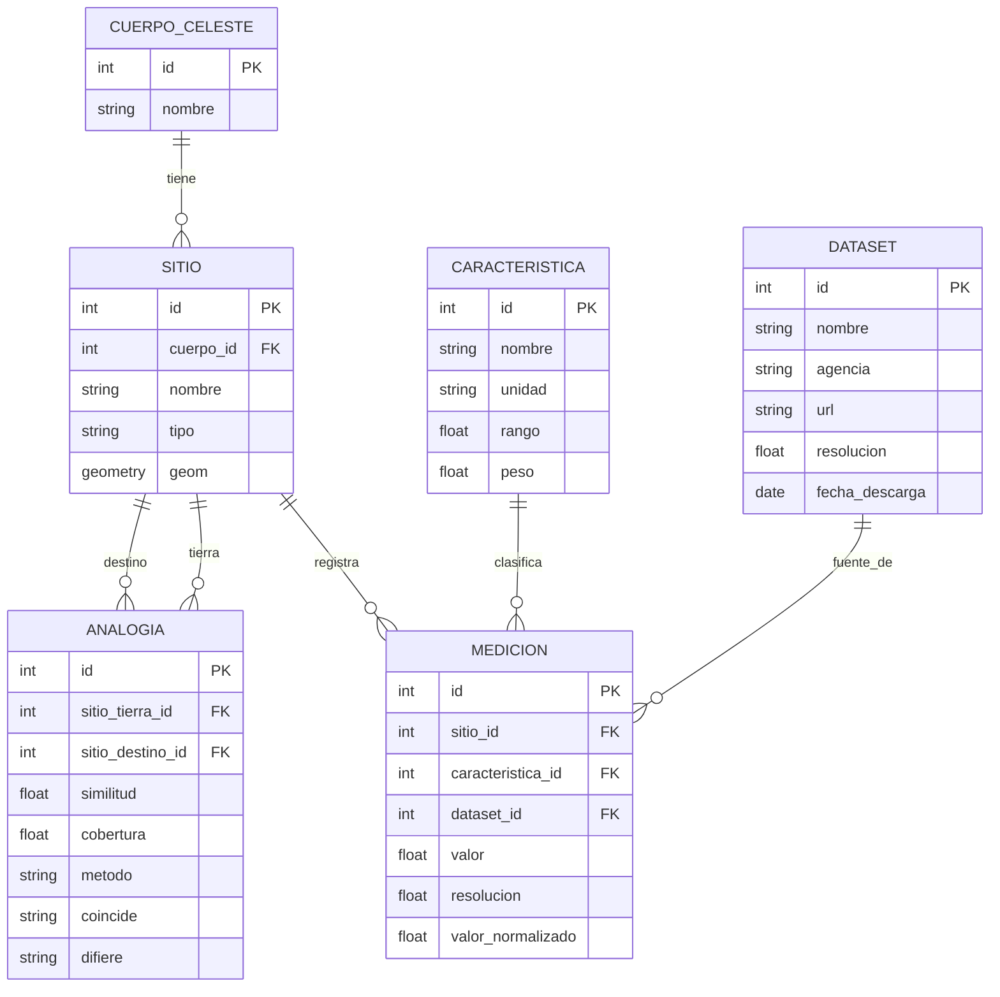

# Base de datos: análogos terrestres de la Luna y Marte

Diseño de base de datos para el reto **"Identify Earth Locations that Analog the Permanent Moon Base Locations and Mars"** (NASA Space Apps Challenge 2026).

> Todos los valores numéricos de los ejemplos son **inventados**, solo sirven para ilustrar el método. Los datos reales saldrían de las fuentes listadas en la sección 2.

## 1. Objetivo

Encontrar lugares de la Tierra que se parezcan a sitios de la Luna o de Marte, medir qué tan parecidos son y explicar en qué coinciden y en qué difieren.

## 2. Fuentes de datos

| Fuente | Cuerpo | Qué aporta | Tablas que alimenta |
|---|---|---|---|
| NASA Earthdata Search | Tierra | Temperatura superficial, elevación, humedad, emisividad | `dataset`, `medicion` |
| NASA Worldview | Tierra | Imágenes para revisar un sitio visualmente | Solo apoyo visual |
| NASA PDS (general) | Marte | Topografía (MOLA), temperatura (THEMIS), imágenes | `dataset`, `medicion` |
| PDS Geosciences LRO / Diviner | **Luna** | Topografía (LOLA) y temperatura (Diviner) | `dataset`, `medicion` |
| CSA (RCM, RADARSAT-1) | Tierra | Radar SAR: rugosidad, hielo, terreno | `medicion` |
| ESA Copernicus / Open Science | Tierra | Sentinel y otros datos terrestres | `dataset`, `medicion` |
| JAXA G-Portal | Tierra | Datos de satélites japoneses | `dataset`, `medicion` |

LRO y Diviner son misiones de la **Luna**, no de Marte. Por eso `cuerpo_celeste` tiene tres filas: Tierra, Luna y Marte.

## 3. Motor recomendado

**PostgreSQL + PostGIS.** El reto trata de ubicaciones, y PostGIS permite guardar coordenadas y polígonos y consultar por distancia o área. Se conecta con PHP mediante PDO. MySQL también funciona, pero los cálculos geográficos habría que hacerlos a mano.

## 4. Diagrama entidad-relación



## 5. Descripción de las tablas

### `cuerpo_celeste`
Define qué se compara con qué: Tierra contra Luna y Tierra contra Marte. Es pequeña, pero sin la fila de la Luna no se cubre la parte del reto sobre bases lunares.

### `sitio`
Es el ancla del modelo. Los datos de NASA vienen como mapas enormes y no como sitios, así que **el equipo decide qué lugares recortar** (un desierto, un cráter, un tubo de lava). El tamaño del sitio debe ser comparable entre cuerpos. `geom` es la columna PostGIS con la ubicación.

### `dataset`
Registra de dónde salió cada dato, lo que da credibilidad científica. Guarda la resolución y la fecha de descarga, porque un dato de 1 km y uno de 5 m no se comparan igual.

### `caracteristica`
Es el criterio de análisis: temperatura, pendiente, rugosidad, hielo, polvo, cuevas. Permite comparar datos de agencias distintas bajo un mismo concepto. Guarda dos campos usados por el cálculo:

- `rango`: amplitud para normalizar (por ejemplo 400 K para temperatura).
- `peso`: importancia de la característica en el puntaje final.

### `medicion`
Es la tabla central y la más grande. Cada fila dice: *en este sitio, esta característica valía tanto, según este dataset*.

| Columna | Tipo | Para qué sirve |
|---|---|---|
| `id` | int, PK | Identificador |
| `sitio_id` | int, FK | Dónde se midió |
| `caracteristica_id` | int, FK | Qué se midió |
| `dataset_id` | int, FK | De qué fuente salió |
| `valor` | float | Número en la unidad original |
| `resolucion` | float (m) | Resolución del dato original |
| `valor_normalizado` | float (0 a 1) | Valor en escala común |

Cómo nace una fila:
1. Se descarga un raster (por ejemplo temperatura MODIS).
2. Se recorta el área del sitio y se resume en **un solo número** (promedio, máximo o mediana).
3. Se convierten las unidades si hace falta (°C a K).
4. Se calcula `valor_normalizado = valor / rango`.

Reglas de integridad:
- `UNIQUE (sitio_id, caracteristica_id, dataset_id)` evita duplicados.
- Las tres claves externas son `NOT NULL`.
- `valor_normalizado` debe estar entre 0 y 1.

### `analogia`
Es el resultado final del proyecto. Cada fila compara un sitio de la Tierra con un sitio de la Luna o de Marte.

| Columna | Para qué sirve |
|---|---|
| `sitio_tierra_id`, `sitio_destino_id` | Los dos sitios comparados |
| `similitud` | Puntaje de 0 a 1 |
| `cobertura` | Qué parte de las características se pudo comparar |
| `metodo` | Cómo se calculó el puntaje |
| `coincide` | Texto: en qué se parecen |
| `difiere` | Texto: en qué difieren (el reto pide explicarlo) |

## 6. Datos de ejemplo

### `cuerpo_celeste`

| id | nombre |
|---|---|
| 1 | Tierra |
| 2 | Luna |
| 3 | Marte |

### `sitio`

| id | cuerpo_id | nombre | tipo | lat | lon |
|---|---|---|---|---|---|
| 1 | 1 | Desierto de Atacama | desierto | -24.50 | -69.25 |
| 2 | 2 | Mare Tranquillitatis | llanura basáltica | 8.50 | 31.40 |
| 3 | 3 | Cráter Jezero | cráter | 18.40 | 77.70 |
| 4 | 1 | Cráter Haughton | cráter de impacto | 75.40 | -89.70 |

### `dataset`

| id | nombre | agencia | resolucion (m) |
|---|---|---|---|
| 1 | MODIS temperatura superficial | NASA (Earthdata) | 1000 |
| 2 | SRTM elevación | NASA (Earthdata) | 90 |
| 3 | Diviner temperatura | NASA (LRO/PDS) | 1000 |
| 4 | LOLA altimetría | NASA (LRO/PDS) | 100 |
| 5 | MOLA altimetría | NASA (PDS) | 463 |
| 6 | THEMIS temperatura | NASA (PDS) | 100 |

### `caracteristica`

| id | nombre | unidad | rango | peso |
|---|---|---|---|---|
| 1 | Temperatura diurna máx. | K | 400 | 0.4 |
| 2 | Pendiente media | ° | 30 | 0.3 |
| 3 | Rugosidad | 0 a 1 | 1 | 0.3 |

### `medicion`

| id | sitio | característica | dataset | valor | resolucion (m) | valor_normalizado |
|---|---|---|---|---|---|---|
| 1 | Atacama | Temperatura | 1 | 320 | 1000 | 0.80 |
| 2 | Atacama | Pendiente | 2 | 4 | 90 | 0.13 |
| 3 | Atacama | Rugosidad | 2 | 0.30 | 90 | 0.30 |
| 4 | Tranquillitatis | Temperatura | 3 | 390 | 1000 | 0.98 |
| 5 | Tranquillitatis | Pendiente | 4 | 3 | 100 | 0.10 |
| 6 | Tranquillitatis | Rugosidad | 4 | 0.25 | 100 | 0.25 |
| 7 | Jezero | Temperatura | 6 | 290 | 100 | 0.73 |
| 8 | Jezero | Pendiente | 5 | 5 | 463 | 0.17 |

Jezero no tiene dato de rugosidad: es el caso de datos faltantes (sección 8).

### `analogia`

| id | sitio_tierra | sitio_destino | similitud | cobertura | metodo |
|---|---|---|---|---|---|
| 1 | Atacama | Tranquillitatis | 0.905 | 100% (3 de 3) | 1 − dif/rango, pesos de `caracteristica` |
| 2 | Atacama | Jezero | 0.943 | 67% (2 de 3) | igual, pesos reajustados a las 2 comunes |

| id | coincide | difiere |
|---|---|---|
| 1 | Pendiente y rugosidad muy parecidas | La Luna es más caliente de día; no hay atmósfera ni la misma gravedad |
| 2 | Temperatura y pendiente cercanas | Falta rugosidad en Marte; cobertura solo del 67% |

## 7. Método de comparación

Para cada característica presente en ambos sitios:

```
similitud_caracteristica = 1 − |valor_A − valor_B| / rango
similitud_final          = Σ (peso × similitud_caracteristica)
```

Ejemplo, Atacama contra Mare Tranquillitatis:

| Característica | Atacama | Luna | Similitud |
|---|---|---|---|
| Temperatura (rango 400) | 320 | 390 | 1 − 70/400 = 0.825 |
| Pendiente (rango 30) | 4 | 3 | 1 − 1/30 = 0.967 |
| Rugosidad (rango 1) | 0.30 | 0.25 | 1 − 0.05/1 = 0.950 |

Puntaje final: 0.825×0.4 + 0.967×0.3 + 0.950×0.3 = **0.905**

## 8. Datos faltantes o no comparables

| Situación | Qué hacer |
|---|---|
| La característica existe solo en un cuerpo | No se compara; la consulta usa `JOIN` y queda fuera |
| Misma característica, distinta unidad | Convertir antes de guardar en `medicion` |
| Misma característica, distinta resolución | Resumir el dato fino al nivel del grueso y guardar `resolucion` |
| Mismo fenómeno, distinto instrumento | Misma fila de `caracteristica`; `dataset_id` indica la fuente |
| No hay nada comparable | No se crea fila en `analogia`, o se marca como datos insuficientes |

Cuando faltan características, los pesos se reajustan para que sumen 1 entre las comunes. Ejemplo (Jezero, sin rugosidad): temperatura 0.4/0.7 = 0.57 y pendiente 0.3/0.7 = 0.43.

`cobertura` guarda el porcentaje de características comparadas. Un puntaje alto con cobertura baja es menos confiable. Se puede fijar un mínimo (por ejemplo, 2 características) para descartar comparaciones débiles.

## 9. Script SQL

```sql
CREATE EXTENSION IF NOT EXISTS postgis;

CREATE TABLE cuerpo_celeste (
  id      SERIAL PRIMARY KEY,
  nombre  VARCHAR(50) NOT NULL UNIQUE
);

CREATE TABLE sitio (
  id         SERIAL PRIMARY KEY,
  cuerpo_id  INT NOT NULL REFERENCES cuerpo_celeste(id),
  nombre     VARCHAR(100) NOT NULL,
  tipo       VARCHAR(50),
  geom       GEOMETRY(Geometry, 4326)
);

CREATE TABLE dataset (
  id              SERIAL PRIMARY KEY,
  nombre          VARCHAR(150) NOT NULL,
  agencia         VARCHAR(100),
  url             TEXT,
  resolucion      DOUBLE PRECISION,
  fecha_descarga  DATE
);

CREATE TABLE caracteristica (
  id      SERIAL PRIMARY KEY,
  nombre  VARCHAR(100) NOT NULL UNIQUE,
  unidad  VARCHAR(20),
  rango   DOUBLE PRECISION NOT NULL CHECK (rango > 0),
  peso    DOUBLE PRECISION NOT NULL CHECK (peso BETWEEN 0 AND 1)
);

CREATE TABLE medicion (
  id                 SERIAL PRIMARY KEY,
  sitio_id           INT NOT NULL REFERENCES sitio(id),
  caracteristica_id  INT NOT NULL REFERENCES caracteristica(id),
  dataset_id         INT NOT NULL REFERENCES dataset(id),
  valor              DOUBLE PRECISION NOT NULL,
  resolucion         DOUBLE PRECISION,
  valor_normalizado  DOUBLE PRECISION CHECK (valor_normalizado BETWEEN 0 AND 1),
  UNIQUE (sitio_id, caracteristica_id, dataset_id)
);

CREATE TABLE analogia (
  id                SERIAL PRIMARY KEY,
  sitio_tierra_id   INT NOT NULL REFERENCES sitio(id),
  sitio_destino_id  INT NOT NULL REFERENCES sitio(id),
  similitud         DOUBLE PRECISION CHECK (similitud BETWEEN 0 AND 1),
  cobertura         DOUBLE PRECISION CHECK (cobertura BETWEEN 0 AND 1),
  metodo            TEXT,
  coincide          TEXT,
  difiere           TEXT,
  UNIQUE (sitio_tierra_id, sitio_destino_id)
);
```

Consulta de similitud entre dos sitios (pesos reajustados a las características comunes):

```sql
SELECT
  SUM(c.peso * (1 - ABS(t.valor - l.valor) / c.rango)) / SUM(c.peso) AS similitud,
  COUNT(*)::float / (SELECT COUNT(*) FROM caracteristica)          AS cobertura
FROM medicion t
JOIN medicion l        ON l.caracteristica_id = t.caracteristica_id
JOIN caracteristica c  ON c.id = t.caracteristica_id
WHERE t.sitio_id = :sitio_tierra
  AND l.sitio_id = :sitio_destino;
```

## 10. Recomendación práctica

No cargar datos de todas las fuentes. Elegir **2 o 3 características con dato en los tres cuerpos** (temperatura y topografía son las más fáciles: Earthdata, Diviner/LOLA y PDS/MOLA) y de 5 a 10 sitios. Así la base tiene datos de calidad y el cálculo de similitud es defendible.

## 11. Limitaciones

- Un único valor por sitio y característica; si se quiere ver la variación (desviación, mínimo, máximo) habría que añadir columnas o una tabla aparte.
- La Tierra no reproduce la gravedad reducida, el vacío lunar, la atmósfera delgada de Marte ni su radiación. El campo `difiere` debe dejarlo explícito.
